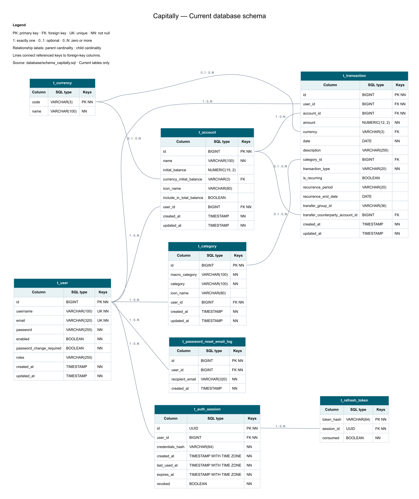

# Database

## Engine

Capitally targets PostgreSQL. Docker Compose uses `postgres:16-alpine`.

## Current Runtime Tables

| Table | Purpose |
| --- | --- |
| `t_auth_session` | Per-login session, user, activity, absolute expiry and revocation |
| `t_refresh_token` | SHA-256 refresh token hashes and consumed rotation history |
| `t_user` | Application users, credentials, enabled flag and roles |
| `t_currency` | Currency code and name |
| `t_account` | User accounts with initial balance and display metadata |
| `t_category` | User-scoped categories |
| `t_transaction` | Income, expense and transfer transactions |
| `t_password_reset_email_log` | Forgot-password email quota accounting |

## Current View

`v_transaction_monthly_report` aggregates monthly totals by user and transaction type, excluding transfer rows through `transfer_group_id IS NULL`.

## Diagram

The ER diagram reflects the eight current tables and eleven foreign-key relationships in [schema_capitally.sql](../database/schema_capitally.sql), including `t_auth_session` and `t_refresh_token`. It shows SQL types, primary/foreign/unique keys, nullability and relationship cardinalities. Legacy budget, investment and asset tables are excluded.

- [SVG diagram](assets/ER_Diagram_Capitally.svg): scalable version for inspecting fields.
- [Graphviz source](assets/ER_Diagram_Capitally.dot): editable diagram source.
- [Generator](assets/generate-er-diagram.cjs): regenerates DOT, SVG and PNG from the SQL schema.

To regenerate, run `node docs/assets/generate-er-diagram.cjs` from the repository root with `@viz-js/viz` and `sharp` available to Node.js (including through `NODE_PATH`). The generator supports the column types and foreign-key syntax currently used in the schema; extend it when introducing new SQL constructs. SQL scripts and JPA entities remain the source of truth.

Session ownership and token history are `t_user` 1:0..N `t_auth_session` and `t_auth_session` 1:0..N `t_refresh_token`. Every session belongs to exactly one user, and every refresh-token hash belongs to exactly one session. Guest sessions can have no refresh token. The database stores token hashes, never raw refresh tokens.

## Sequences

The current JPA mappings use:

- `user_seq`
- `account_seq`
- `categories_id_seq`
- `transaction_seq`
- `password_reset_email_log_seq`

## Important Relationships

- `t_user` 1:N `t_auth_session` 1:N `t_refresh_token`
- `t_user` 1:N `t_account`
- `t_user` 1:N `t_category`
- `t_user` 1:N `t_transaction`
- `t_currency` 1:N `t_account` through `currency_initial_balance`
- `t_currency` 1:N `t_transaction` through `currency`
- `t_account` 1:N `t_transaction`
- `t_category` 1:N `t_transaction`
- `t_account` 1:N `t_transaction.transfer_counterparty_account_id`
- `t_user` 1:N `t_password_reset_email_log`

## Script Inventory

| Script | Purpose |
| --- | --- |
| `add_auth_sessions.sql` | Idempotent persistent-session migration; apply before backend deployment |
| `schema_capitally.sql` | Clean schema aligned with current entities |
| `trigger_capitally.sql` | Adds `updated_at` maintenance triggers |
| `view_schema_capitally.sql` | Creates/replaces monthly transaction report view |
| `align_core_schema_current.sql` | Idempotent helper for older local schemas |
| `add_currency_initial_balance_to_account.sql` | Legacy incremental account currency migration |
| `add_account_icons_and_transfers.sql` | Legacy incremental icons/transfers migration |
| `seed_guest_demo_data.sql` | Demo data for user id `1` |

## Notes

- `SPRING_JPA_HIBERNATE_DDL_AUTO=update` is useful in development, but production should prefer controlled SQL migrations.
- The demo seed assumes a user with `id = 1` already exists.
- The current application no longer maps the older budget, investment, asset and exchange-rate tables that appeared in early documentation.
